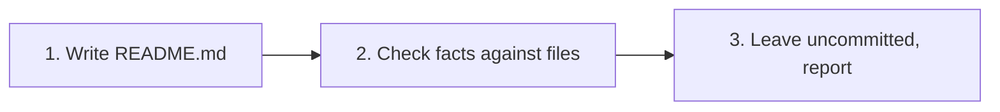

# Add README.md to /tmp/omp-proto

## Context

Add a `README.md` at `/tmp/omp-proto/README.md` that explains what each file in this prototype folder is. The folder holds a git repo with no commits and these files, all checked this session:

- `blocks.json`: 43 mermaid blocks (`{file, lang, src, ts}`) taken from 22 session `.jsonl` logs.
- `chat-before.png`: the Ovis Terminal view. The table renders, mermaid falls back to ASCII, and the SVG shows as a striped placeholder.
- `chat-lens.png`: the Ovis Chat view. The table, the mermaid chart and the SVG all render.
- `omp-strings.txt`: a 42 MB `strings` dump of the omp binary (Bun Mach-O), 1,261,620 lines.

The plan has exactly three steps. Creating the file is the only change. Do not commit: the user hasn't asked for a commit, and the repo has no commits.

## Approach

1. **Write the README.** Create `/tmp/omp-proto/README.md` with the exact content given in Step 1 below. Stop if the file already exists.
2. **Check facts against files.** Run the `jq`/`ls` checks in Step 2 and fix any count or row that doesn't match.
3. **Leave it uncommitted and report.** Don't `git add` or commit. Report the path and the check results.



### Step 1: Write the README

Create `/tmp/omp-proto/README.md` with the `write` tool. Use exactly this content:

````markdown
# omp-proto

A scratch prototype for comparing how Ovis shows rich omp reply blocks (tables, mermaid, SVG) in its Terminal and Chat views.

## Files

| File | What it is |
|---|---|
| `blocks.json` | 43 mermaid blocks (`file`, `lang`, `src`, `ts`) taken from 22 omp session logs; a test set for the renderer. |
| `chat-before.png` | Ovis Terminal view: the table renders, mermaid falls back to ASCII, and the SVG shows as a placeholder. |
| `chat-lens.png` | Ovis Chat view: the table, mermaid and SVG all render. |
| `omp-strings.txt` | `strings` dump of the omp binary (~42 MB), used to look up how omp marks up blocks. Too large to commit. |
````

If `README.md` already exists, stop and report it. Do not overwrite it.

### Step 2: Check the README against the files

From `/tmp/omp-proto`, run:

```sh
jq 'length' blocks.json                 # expect 43
jq '[.[].file]|unique|length' blocks.json   # expect 22
ls chat-before.png chat-lens.png omp-strings.txt
```

If a count differs, change only the matching number in the README. If a file is missing, delete its row.

### Step 3: Leave it uncommitted and report

Do not `git add` or commit. Tell the user the path `/tmp/omp-proto/README.md` and what the step 2 checks returned.

## Verification

- `test -f /tmp/omp-proto/README.md && grep -c '^| `' /tmp/omp-proto/README.md` prints `4` (one table row per file).
- `git -C /tmp/omp-proto status --porcelain` lists `?? README.md`, which shows the file is new and uncommitted.

## Assumptions & contingencies

- The README describes only the files that exist now. If more files show up before you run this, add one table row for each, in the same format.
